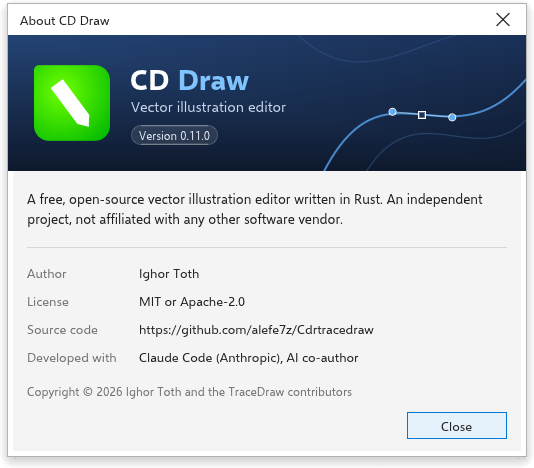

# حول CD Draw

CD Draw مجاني ومفتوح المصدر. تشرح هذه الصفحة كيف ترى الإصدار الذي لديك.

## مربع حول {#about}

اختر [[menu.help > menu.help.about]] لترى الإصدار الذي تشغله والمؤلف والترخيص
ورابطًا إلى الشيفرة المصدرية وما بُني به البرنامج. اضغط [[dialog.close]] أو
<kbd>Enter</kbd> أو <kbd>Esc</kbd> لإغلاقه.

## شاشة الترحيب {#welcome-screen}

شاشة الترحيب هي علامة التبويب الأولى عند بدء CD Draw. منها يمكنك إنشاء رسم،
وفتح أحد آخر الرسومات التي استخدمتها (لكل منها صورة مصغرة؛
[[menu.file.clear_recent]] ينساها)، والبدء من قالب، وقراءة الأخبار، والعثور
على مواد التعلم. اختر [[menu.help > menu.help.welcome_screen]] لإعادتها.
تفتح [[menu.help > menu.help.video_tutorials]] و[[menu.help.quick_start_guide]]
و[[menu.help.user_guide]] صفحة التعلم فيها، ويفتح [[menu.help.whats_new]]
أخبارها.

[[menu.help > menu.help.message_settings]] يفتح الخيارات التي تُضبط فيها
رسائل CD Draw.
