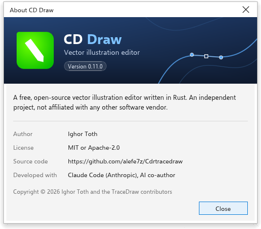

# Sobre o CD Draw

O CD Draw é livre e de código aberto. Esta página explica como ver qual
versão você tem e como voltar à Tela de boas-vindas.

## A caixa Sobre {#about}

Escolha [[menu.help > menu.help.about]] para ver a versão em uso, o autor, a
licença, o endereço do código-fonte e com o que o programa é feito. Pressione
[[dialog.close]], <kbd>Enter</kbd> ou <kbd>Esc</kbd> para fechá-la.

A cópia instalada pela Microsoft Store e o app para Android são atualizados
pela loja: nunca consultam o GitHub, [[menu.help > menu.help.updates]] abre a
página deles na loja, e as opções não têm verificação de atualizações. Toda
outra instalação baixa o arquivo feito para o seu processador e para o modo
como foi instalada (instalador, zip portátil, AppImage, `.deb`, arquivo
compactado ou imagem de disco).

## A Tela de boas-vindas {#welcome-screen}

A Tela de boas-vindas é a primeira guia quando o CD Draw inicia. Nela você
pode criar um desenho, abrir um dos desenhos usados por último (cada um com uma
miniatura; [[menu.file.clear_recent]] esquece a lista), começar a partir de um
modelo, ler as notícias e encontrar material de aprendizado. Quando uma página
é mais alta que a janela (uma lista longa de desenhos recentes), ela rola com a
roda do mouse ou com a barra de rolagem; a fileira de guias no alto fica no
lugar. Escolha
[[menu.help > menu.help.welcome_screen]] para trazê-la de volta.
[[menu.help > menu.help.video_tutorials]], [[menu.help.quick_start_guide]] e
[[menu.help.user_guide]] abrem a página de aprendizado, e
[[menu.help.whats_new]] as notícias.

[[menu.help > menu.help.message_settings]] abre as opções em que as mensagens
do CD Draw são configuradas.
